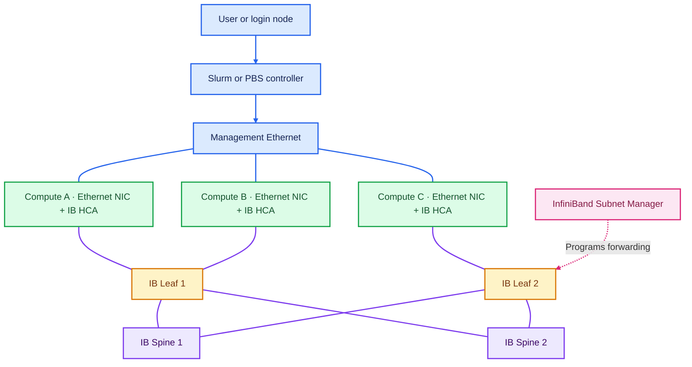

## 1. Color-coded HPC cluster architecture

| Color | Component | What it does |
|---|---|---|
| 🔵 Blue | Management Ethernet | Carries traffic such as SSH and scheduler communication in this example. |
| 🟢 Green | Compute nodes | Each node has an Ethernet NIC and an IB **Host Channel Adapter (HCA)**. |
| 🟠 Orange | Leaf switches | Connect directly to the compute-node HCAs. |
| 🟣 Purple | Spine switches | Connect the leaves and provide multiple paths between them. |
| 🩷 Pink | Subnet Manager | Discovers the IB fabric, assigns local identifiers (LIDs), and programs forwarding across the subnet. The dotted line represents management of the fabric. |

**Trace an MPI message in the diagram.** From **Compute A to Compute B**, the traffic crosses **Leaf 1** only. From **Compute A to Compute C**, it takes a path such as **Leaf 1 → Spine 1 → Leaf 2**. The second path uses uplink capacity shared with other jobs. That’s why the same job can behave differently depending on which nodes it gets. [docs.nvidia.com](https://docs.nvidia.com/base-command-manager/product-manuals/admin/configuring?utm_source=chatgpt.com)

## 2. InfiniBand history, speed, and topology

InfiniBand’s first specification was released in **October 2000**. It was designed as a switched interconnect for server and storage communication, with features such as **RDMA** that are valuable in HPC. [docs.nvidia.com](https://docs.nvidia.com/cabling-data-centers.pdf?utm_source=chatgpt.com)

| What you hear at work | What it tells you | Example |
|---|---|---|
| **FDR, EDR, HDR, NDR, XDR** | Link speed generation | Typical 4-lane rates are **56, 100, 200, 400, and 800 Gb/s**, respectively. Check the negotiated rate on the actual port. |
| **Single switch, fat-tree, Dragonfly+, torus** | How the switches are wired | A two-tier fat-tree uses leaves and spines. Dragonfly+ organizes switches into groups. A torus uses a grid with wraparound links. |
| **Native IB verbs, IPoIB** | How software uses the fabric | An MPI stack can use native IB through a transport such as UCX. IPoIB carries IP traffic over IB, so an IPoIB `ping` tests IP connectivity. |

So **“NDR fat-tree”** tells you two independent facts: the **speed generation** and the **switch topology**. An **HDR fat-tree** can have the same layout with different link speeds. [infinibandta.org](https://infinibandta.org/infiniband-roadmap/?utm_source=chatgpt.com)

## 3. What happens during a real HPC job?

Imagine a **16-node Fluent CFD job**. Each MPI rank works on a portion of the mesh. At points in the solve, ranks exchange values along the boundaries of their portions. If the neighboring rank is on another server, the message travels through the IB fabric when the MPI job is configured to use it.

- **Latency** matters when ranks frequently wait for small messages.
- **Bandwidth** matters when ranks move larger amounts of data.
- **RDMA** allows an HCA to transfer data to or from registered remote memory without requiring the remote CPU to copy each transfer. [docs.nvidia.com](https://docs.nvidia.com/cabling-data-centers.pdf?utm_source=chatgpt.com)

### Why link speed alone can mislead you

Suppose each NDR leaf has **32 × 400 Gb/s** host links and **16 × 400 Gb/s** uplinks. The hosts can inject **12.8 Tb/s**, while the uplinks can carry **6.4 Tb/s** in the same direction. That’s **2:1 leaf oversubscription**. If many nodes send off-leaf at once, they share those uplinks even though every host port reports a 400 Gb/s link. Same-leaf traffic stays local.

## 4. Apply the diagram to your four-node IB outage scenario

| What you observe | Where to look first |
|---|---|
| All four nodes are on the **same leaf**, and their ports are physically down | Check the shared leaf’s health, power, and affected switch ports. Compare against a healthy node on that leaf if one is available. |
| Physical links are up, but IB ports stay in **`INIT`** | Verify that an active Subnet Manager can discover the affected ports and initialize them. |
| Same-leaf communication works, but cross-leaf communication fails | Check leaf uplinks, spine ports, and fabric forwarding. |
| IB ports are **`ACTIVE`**, but the MPI job hangs or runs slowly | Verify which transport and HCA port the job actually selected. Compare a known-good pair with an affected pair using an RDMA test such as `ib_write_bw`, then check port errors and congestion. |

**For a senior HPC interview, learn fat-tree first.** Walk the interviewer through the packet path, explain where bandwidth is shared, then use the topology to narrow down the failure. The strongest first step in the four-node scenario is to **map all four HCA ports to their physical switch ports** and see what they have in common.
